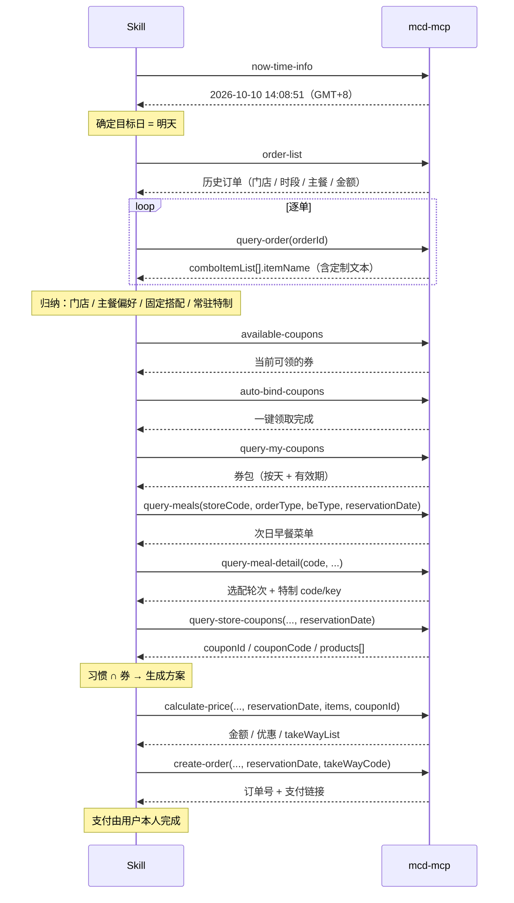

# MCP 集成说明 · mcd-breakfast-tomorrow

本文件说明本项目**实际调用**的麦当劳 MCP Server、Tool、调用流程与业务价值。

---

## 一、使用的 MCP Server

| 项 | 值 |
|---|---|
| 名称 | `mcd-mcp` |
| 服务提供方 | 麦当劳中国（官方托管） |
| 接入地址 | `https://mcp.mcd.cn` |
| 传输协议 | Streamable HTTP |
| 鉴权 | 请求头 `Authorization: Bearer <MCD_MCP_TOKEN>` |
| 工具总数 | 34（本项目使用其中 12 个） |

> Token 通过环境变量注入，**不写入仓库**。配置示例见 [`mcp-config.example.json`](./mcp-config.example.json)。

---

## 二、实际使用的 Tool

| # | Tool | 在本项目中的用途 |
|---|---|---|
| 1 | `now-time-info` | 对齐服务端时间，避免跨天/时区误判（决定"明天"是哪天） |
| 2 | `query-nearby-stores` | 建档时确认门店与**是否支持预约**，读取次日可预约时段 |
| 3 | `order-list` | 读历史订单，识别高频门店、时段、主餐与固定搭配 |
| 4 | `query-order` | **逐单读取特调定制信息**（`itemName`），归纳常驻特制 |
| 5 | `query-meal-detail` | 读取餐品的选配轮次与**特制项 code/key**，以及可替换项与差价 |
| 6 | `query-meals` | 带 `reservationDate` 拉取**次日早餐菜单** |
| 7 | `available-coupons` | 查询当前**可领取**的券 |
| 8 | `auto-bind-coupons` | **一键领取**全部可领券（券不会自己进卡包） |
| 9 | `query-my-coupons` | 读取券包（含**按天发放、当天 05:00–10:29 有效**的早餐券） |
| 10 | `query-store-coupons` | 查当前门店**真正可用**的券，并取回 **`couponId` / `couponCode`** 与适用商品 |
| 11 | `calculate-price` | 试算金额、优惠、应付，并取回 `takeWayList` 中的取餐方式 code |
| 12 | `create-order` | 带 `reservationDate` 创建预约订单，返回订单号与支付链接 |

---

## 三、调用流程



### 分阶段说明

**① 建档（一次性）**
`now-time-info` → `query-nearby-stores`（`beType=1`，`searchType=1` 取收藏门店）→ 记录 `storeCode`、`reservation`、`reservationTimeOptions`。

**② 学习惯**
`order-list` 取单号 → 逐单 `query-order` 取 `comboItemList[].itemName` → 归纳出：固定门店、出没时段、主餐偏好、固定搭配、**常驻特制**。

**③ 领券 → 筛券（顺序不可颠倒）**
`available-coupons`（可领）→ `auto-bind-coupons`（一键领）→ `query-my-coupons`（按**目标日**筛出有效的券）。

**④ 拉次日菜单**
`query-meals` 带 `reservationDate`（格式 `yyyy-MM-dd HH:mm`）→ 返回**次日早餐品类**，同时确认券对应商品当前仍在售。

**⑤ 取交集并试算**
`习惯 ∩ 券适用商品` → 用 `query-meal-detail` 解析特制 code/key → `query-store-coupons` 取 `couponId`/`couponCode` → `calculate-price` 试算。

**⑥ 建单**
`create-order` 带 `reservationDate` 与 `takeWayCode` → 返回订单号 + 支付链接。**支付由用户本人完成。**

---

## 四、关键参数发现（实测）

### 4.1 `reservationDate` —— 这不是"预约附加项"，而是"查询维度"

`query-meals` / `query-meal-detail` / `calculate-price` / `create-order` **四个工具都支持 `reservationDate`**，格式 `yyyy-MM-dd HH:mm`。

实测（同一门店、同一时刻 14:08）：

| 调用 | 返回 |
|---|---|
| **带** `reservationDate=2026-10-11 07:30` | 早餐菜单（如麦满分系列、豆浆、薯饼） |
| **不带** | 午餐下午茶菜单（巨无霸 / 随心配 1+1 / 500 大卡套餐…） |

**结论：非早餐时段可查到次日早餐菜单。这是本项目能成立的技术前提。**

### 4.2 `modification` —— 特制必须成组回传

```json
{
  "code": "100141",
  "name": "吉士",
  "selectedKey": "0-1",
  "unselectedKey": "0-0"
}
```

规则：

- 该组内**所有**特制项都必须传给 `calculate-price` / `create-order`；
- 选中的用 `selectedKey`，未选中的用 `unselectedKey`；
- 组 `minValues=1 && maxValues=1` 且仅一项时为**必选**，不可不选。

### 4.3 两个易踩的参数

| 参数 | 要点 |
|---|---|
| `takeWayCode` | `orderType=1` 必传，取自 `calculate-price` 返回的 `takeWayList[].code`（如 `eat-in` / `take-in-store` / `take-dt-quick`）；`orderType=2` 不传 |
| `withOrder` | 商品若标 `随单购早餐卡优惠`，**必须同时购买早餐卡**才享该价，否则按原价结算 |

### 4.4 数据结构差异（重要）

| 场景 | 特制信息位置 |
|---|---|
| 单品 | `modification.items[].values[]` |
| **套餐** | `roundList[].comboItemList[].modification` ← **与单品路径不同** |
| 历史订单（列表） | `order-list` **不含**定制字段 |
| 历史订单（详情） | `query-order` 的 `comboItemList[].itemName`（**自然语言文本**，需解析映射） |

### 4.5 券：`couponId` / `couponCode` 的来源，以及"时刻可用性"

**来源**：只有 `query-store-coupons` 返回 `couponId` 与 `couponCode`；它还返回 `tradeDateTime` 与 **`products[].productCode`（券的适用商品）**。
`available-coupons` 与 `query-my-coupons` **都不提供** id/code。

**时刻可用性（实测，同一账户、同一时刻 11:27，目标日 = 次日 07:30）**：

| 接口 | 返回 |
|---|---|
| `query-my-coupons` | 12 张，含「次日的早餐券，有效期 次日 05:00–10:29」 |
| `query-store-coupons(reservationDate=次日 07:30)` | **1 张**（当日有效的那张），**未返回次日早餐券** |

**结论：`query-store-coupons` 按"当前时刻"判定券是否可用，`reservationDate` 不会让它提前返回"未来才生效"的券。**

**由此产生的建单策略**：

| 情形 | 处理 |
|---|---|
| 券在目标日**已可用** | 直接按预约建单 |
| 券**尚未生效** | **不提前建单**；落成方案，到目标日早餐时段再建单（届时券已可用，可正常取到 `couponId`/`couponCode`） |

> 提前建单会挂不上券、或按原价结算。

### 4.6 `realTotalAmount` 不能用来推断价格偏好

`order-list` 的 `realTotalAmount` 受券影响极大 —— 用券核销的订单可能为 **¥0**。
因此本项目**不使用它推断用户的价格偏好**，价格判断一律基于商品 `originalPrice` 或 `calculate-price` 结果。

---

## 五、业务价值

| 能力 | 对应现实问题 | 价值 |
|---|---|---|
| **次日菜单可查** | 早上没时间研究吃什么 | 把决策挪到前一晚 |
| **领券 + 习惯 ∩ 券** | 券按天发放、当天 10:29 作废，容易被浪费 | 让"对味"和"省钱"同时成立 |
| **常驻特制自动带上** | 每次点单都要手动做同一项特制调整 | 免去重复配置，且减少出错 |
| **预约建单** | 早上到店要等餐 | 到店即取的体验 |

---

## 六、已知限制

1. **支付必须人工**。`create-order` 只返回订单号与支付链接，官方不提供免密代付。本项目所有输出措辞均为「订单已创建，请在 X 分钟内完成支付」。
2. **SKU 会变动**。实测中出现餐品下架（返回 `60001 未匹配到商品`），特制映射需具备降级能力。
3. **券在生效前无法挂到订单上**。见 4.5，需按券的可用性分流建单时机。
4. **金额单位为分**。`calculate-price` 返回的价格需除以 100 转为元。
5. **运行环境**：依赖客户端已配置 `mcd-mcp` 连接器与有效 Token；连接器按客户端分别生效。
