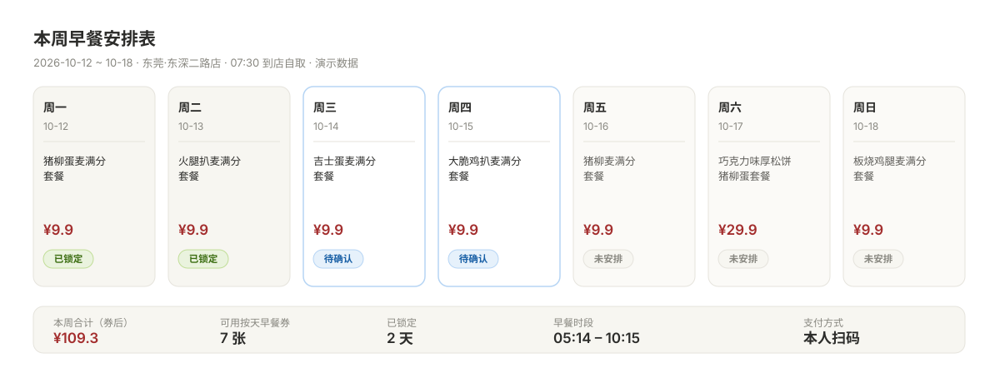
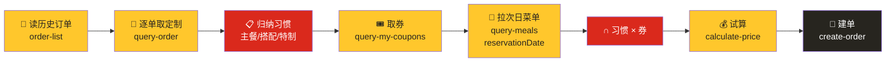

<div align="center">

# 麦麦早餐管家 · mcd-breakfast-tomorrow

**明早那张 ¥9.9 的券，今晚就替你锁定了。**

你只需要回一个「好」。


</div>

---

> 觉得有用的话，点个 **⭐ Star** 支持一下！这是麦当劳程序员节创意开发大赛参赛作品，Star 越多排名越靠前。

> 🔗 **在线演示（不用安装、不用 Token，点开就能看）** → https://hjuyam.github.io/mcd-breakfast-tomorrow/

---

## 😩 你有没有过这种早上

- 出门前随手刷一下麦当劳 App，发现**今天有一张 ¥9.9 的早餐券**
- 但已经 08:20 了，早餐券 **10:29 就作废**
- 你站在柜台前一边排队一边纠结"该用哪张券、点什么"，最后随便点了，券也没用干净

麦当劳的早餐券是**按天发放、只在当天 05:00–10:29 有效**的。
真正的问题不是"早上吃什么"，而是——**这件事根本就不该在早上处理。**

**这个 Skill 把它挪到前一晚做完。**

---

## 🌙 它做的事，就一件

**在你睡前，把明早那一单准备好。**

- 它读得懂你的**常点习惯**（主餐偏好、固定搭配、常驻特制）
- 它算得清你手上的**早餐券**（哪天哪张、什么时候过期）
- 它把两者**取交集**，给出明早的方案，并算好价
- 你回一个「好」，它就建单并把支付链接给你

早上你到店，**拿了就走**。

---

## 📅 那张图：本周早餐安排表

它不是给你一张菜单，而是给你**一张排好的表**——哪天用哪张券、吃什么、多少钱、状态如何。



> 上图由真实 MCP 数据生成（演示数据已脱敏）。它会直接成为你周五晚上看到的那一屏。

---

## 🧠 它会记住什么

| 记住什么 | 例子（演示数据） | 怎么来的 |
|---|---|---|
| 固定门店与取餐时间 | 深圳·科技园店，07:30 到店自取 | 建档时写死，不动态选店 |
| 主餐偏好 | 鸡扒类 | 高频订单的主餐类别 |
| 固定搭配 | 优品豆浆小杯 | 反复出现的子项 |
| **常驻特制** | 麦香鸡酱：不要 / 吉士：不要 | **逐单**读取历史定制后归纳 |
| 出没时段 | 08:09–08:18 | 历史下单时间 |

> **"懂我"不是形容词，是可以从你真实订单里读出来的事实——而且不需要机器学习。**

---

## 🚀 快速开始

### 1️⃣ 申请麦当劳 MCP Token

前往 [open.mcd.cn/mcp](https://open.mcd.cn/mcp) 手机号登录 → 控制台 → 激活，拿到 MCP Token。

### 2️⃣ 配置 MCP Server

把 [`mcp-config.example.json`](./mcp-config.example.json) 的内容加入你的客户端 MCP 配置，**把 Token 换成你自己的**：

```json
{
  "mcpServers": {
    "mcd-mcp": {
      "type": "streamablehttp",
      "url": "https://mcp.mcd.cn",
      "headers": {
        "Authorization": "Bearer ${MCD_MCP_TOKEN}"
      }
    }
  }
}
```

### 3️⃣ 安装 Skill

把 `skills/mcd-breakfast-tomorrow/` 整个目录放进你客户端的 skills 目录（例如 WorkBuddy 的 `.workbuddy/skills/`）。

### 4️⃣ 建一次档，然后说一句话

```text
你：安排一下明早的早餐

它：明早 07:30，深圳·科技园店，到店自取
    🍔 大脆鸡扒麦满分套餐（麦香鸡酱：不要）
    🥛 优品豆浆小杯
    🎟️ 用【周四大脆鸡扒堡早餐两件套】券
    💰 ¥9.9（原价 ¥18.5）
    这单要今晚锁定吗？回「好」我就下单

你：好

它：订单已创建 ✅ 请在 15 分钟内完成支付
    🔗 https://...
    ⏰ 支付截止 14:52
```

---

## 🔍 它是怎么做到的



**核心不是"推荐"，是取交集：`你的习惯 ∩ 当天有效的券`。**

- 只按券推 → 会推给你不爱吃的
- 只按习惯推 → 会浪费掉当天的券
- **两者取交集，才是"既对味、又省钱"的那一单**

完整工具清单与调用细节见 [`MCP_INTEGRATION.md`](./MCP_INTEGRATION.md)。

---

## 🧩 三个真实存在的坑（本项目已处理）

| 坑 | 说明 | 处理方式 |
|---|---|---|
| **随单购价格陷阱** | 部分餐品标着 `随单购早餐卡优惠`（如 ¥7.2 / 原价 ¥12），**必须同时购买早餐卡**才享该价，否则按原价结算 | 识别 `withOrder` 字段，不满足条件时按原价展示 |
| **特制参数字典** | 历史订单里的定制是**文本**（`麦香鸡酱(不要)`），而下单需要 `code + key` | 逐单品拉 `query-meal-detail`，建立「文本 → code/key」映射表 |
| **SKU 会下架** | 昨天还能点的餐品，今天可能返回 `60001 未匹配到商品` | 映射缺失时降级为同类替代，不硬失败 |

---

## 🙅 边界与诚实

- **支付必须由你本人完成**。麦当劳官方不提供免密代付，本项目只创建订单并返回支付链接，**不会、也不能替你付款**。所以本项目的说法永远是「订单已创建，请在 X 分钟内完成支付」，而不是「已帮你订好早餐」。
- 餐品信息、价格及供应状态以**麦当劳官方渠道的实时结果**为准。
- 本项目为麦当劳程序员节创意开发大赛**参赛作品，由参赛者独立开发，非麦当劳官方产品**。
- 仓库内不包含任何真实 Token、密钥或账号凭证；演示数据均为虚构。

---

## 📁 仓库结构

```
mcd-breakfast-tomorrow/
├── README.md                       # 你正在看的这份
├── CONTEST_DECLARATION.md          # 参赛声明（官方原文）
├── MCP_INTEGRATION.md              # 实际调用的 MCP 工具与业务价值
├── mcp-config.example.json         # 脱敏配置示例
├── workbuddy.md                    # WorkBuddy 开发对话上下文
├── docs/
│   └── index.html                  # 在线演示站（GitHub Pages）
├── assets/
│   └── weekly-plan.svg             # 「本周早餐安排表」示意图
└── skills/mcd-breakfast-tomorrow/
    ├── SKILL.md                    # Skill 主体
    └── references/
        ├── mcd-tools.md            # 工具调用顺序与参数要点
        └── breakfast-rules.md      # 早餐时段、券、特制规则
```

---

## ⭐ 如果它让你的早上省了心

点个 **Star** 吧。这是麦当劳程序员节创意开发大赛的参赛作品，你的每一颗 Star 都算数。

**本项目为麦当劳程序员节创意开发大赛参赛作品，由参赛者独立开发，非麦当劳官方产品。**
